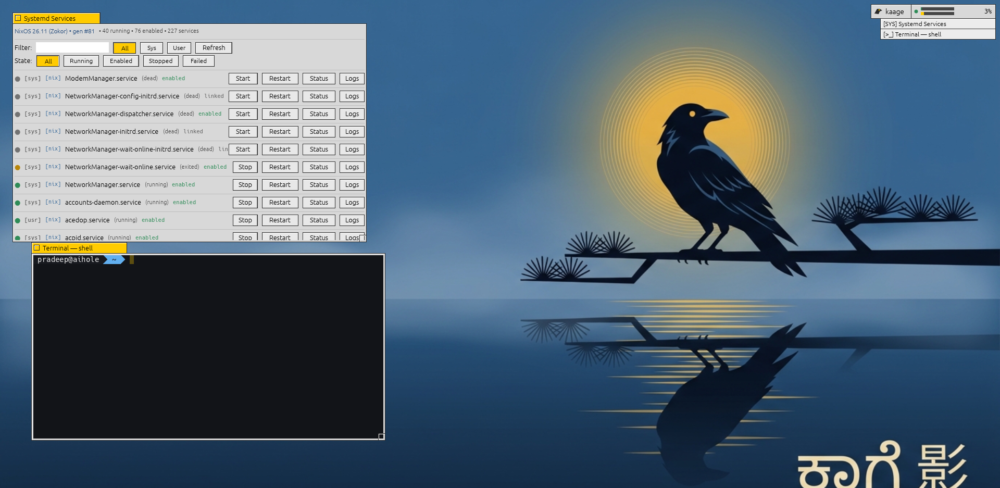

# kaage (ಕಾಗೆ / 影)

A single-user, BeOS-inspired browser desktop environment built in Rust for inspecting and controlling a Linux host's systemd services (system + user), containers, live host metrics, and interactive PTY terminals over Tailscale.



## Workspace Layout

- [`crates/kaage-proto`](crates/kaage-proto) — Shared `postcard` wire protocol (`ClientMsg`, `ServerMsg`, `SystemdUnitInfo`, `ContainerInfo`, `HostMetrics`).
- [`crates/kaaged`](crates/kaaged) — Linux host daemon (`axum` + `tokio`, `zbus` system & user D-Bus, `bollard` Docker/Podman, `portable-pty`, `sysinfo`, `Tailscale-User-Login` auth).
- [`crates/kaage-ui`](crates/kaage-ui) — Mission-Control Webtop (`eframe`/`egui` + `ewebsock`, IBM Plex Sans/Mono typography, `libghostty-vt` optional native terminal backend + pure-Rust `vt100` WASM fallback), compiles to both `wasm32-unknown-unknown` and native desktop.
- [`flake.nix`](flake.nix) + [`nix/`](nix) — Reproducible Nix packages (`kaaged`, `kaage-ui`, `kaage-ui-native`, `kaage`), NixOS module (`nixosModules.default`), and Home Manager module (`homeManagerModules.default`).

## Terminal Engine (`libghostty-vt` & Kitty Keyboard Protocol)

`kaage-ui` is designed around [`libghostty-vt`](https://ghostty.org) (`ghostty-vt 0.8`, available via the `ghostty` Cargo feature on native targets) with a pure-Rust `vt100` fallback for zero-Zig offline Nix WASM builds:

- **High-fidelity VT emulation**: Full 24-bit truecolor, Unicode grapheme clustering, synchronized output (DEC mode 2026, eliminating TUI flicker), and low-latency GPU-accelerated canvas rendering without `xterm.js` DOM overhead.
- **Kitty Keyboard Protocol (`CSI u`)**: Supported by `libghostty-vt`. Legacy VT100/xterm collapses distinct chords into identical control bytes (`Ctrl+I` = `Tab`, `Ctrl+M` = `Enter`, `Ctrl+[` = `Esc`) and cannot represent modified keys like `Shift+Enter` or `Ctrl+Shift+letter`. The Kitty Keyboard Protocol transmits unambiguous keycodes, modifier bitmasks, and press/repeat/release events — critical for modern editors and multiplexers (**Neovim, Helix, tmux, Zellij**) and for reliable key handling in browser-hosted terminals.

## Deploying on NixOS (`btbytes/nixos-dotfiles` / `aihole`)

### Option A (Recommended): NixOS Module (`services.kaage`)

Runs `kaaged` at boot as your user (`my.username`), installs a scoped Polkit rule so you can start/stop/restart system units from the UI without interactive prompts, inspects both system **and** user systemd services (`acedop`, `comfyui`, `unsloth`, `emacs`, `llama-cpp`, etc.), and declaratively exposes kaage via `tailscale serve`.

1. **Add `kaage` to `flake.nix` inputs** (use `path:/home/pradeep/projects/kaage` while iterating locally, or `github:btbytes/kaage` once pushed):

```nix
inputs = {
  # ...existing inputs...
  kaage = {
    url = "github:btbytes/kaage"; # or "path:/home/pradeep/projects/kaage"
    inputs.nixpkgs.follows = "nixpkgs";
  };
};
```

2. **Import the NixOS module in `flake.nix`** under `nixosConfigurations.aihole.modules`:

```nix
modules = [
  ./hardware-configuration.nix
  ./configuration.nix
  inputs.kaage.nixosModules.default
  # ...home-manager module...
];
```

3. **Enable `services.kaage` in `configuration.nix`** (accept `my` in the top-level args `{ config, pkgs, my, ... }:`):

```nix
services.kaage = {
  enable = true;
  user = my.username;
  port = 9090;
  allowedUser = "pradeep@btbytes.com"; # match your Tailscale login
  tailscaleServe = {
    enable = true;
    httpsPort = 9090; # https://aihole.<tailnet>.ts.net:9090
  };
};
```

4. **Rebuild**:

```bash
sudo nixos-rebuild switch --flake ~/dotfiles#aihole
```

### Option B: Home Manager Module (`kaageModule`)

Mirrors the `homeModules/acedop/default.nix` pattern for running `kaaged` as a `systemd.user` service:

1. Import `inputs.kaage.homeManagerModules.default` in `home.nix` (accept `inputs` in args).
2. Enable in `home.nix`:

```nix
kaageModule = {
  enable = true;
  autoStart = true;
  port = 9090;
  allowedUser = "pradeep@btbytes.com";
};
```

3. Add `9090` to `tailscale-serve-local` and `networking.firewall.interfaces."tailscale0".allowedTCPPorts` in `configuration.nix`.

## Local Development

```bash
# Enter Nix dev shell (or use local rustup + trunk)
nix develop

# Run unit tests
cargo test --workspace

# Start daemon locally (no Tailscale header check when KAAGE_ALLOWED_USER is unset)
cargo run -p kaaged

# Serve live-reloading WASM UI proxied to kaaged (http://127.0.0.1:8080)
trunk serve

# Or launch the native desktop client directly
cargo run -p kaage-ui
```

## Environment Variables (`kaaged`)

| Variable | Default | Description |
| :--- | :--- | :--- |
| `KAAGE_BIND` | `127.0.0.1:9090` | HTTP/WebSocket listen address |
| `KAAGE_DIST_DIR` | `dist` | Static directory serving the built WASM webtop |
| `KAAGE_ALLOWED_USER` | *(unset)* | Required `Tailscale-User-Login` header value |
| `KAAGE_CONTAINER_CLI` | `docker` | Container CLI binary used by the `Shell` button (e.g. `podman`) |

## License

MIT License — Copyright © 2026 [Pradeep Gowda](https://linkedin.com/in/btbytes). See [`LICENSE`](LICENSE) for details.
